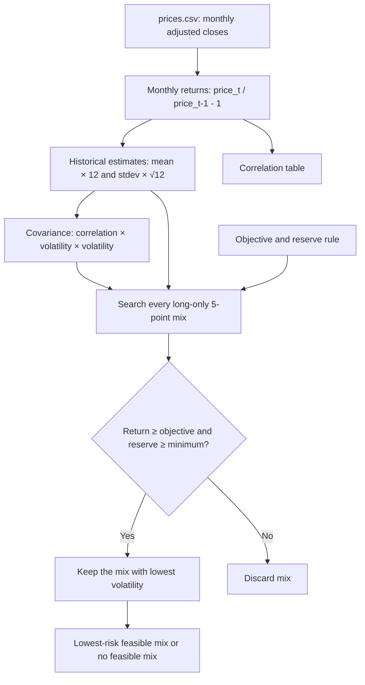

# Lab 15 — Portfolio Stability Decision

## Question

Which long-only mix carries the least risk while meeting the 6.5% expected-return objective and the 3.0% reserve rule, and does the answer survive a one-point change in an estimate?

This work was built with AI help as a learning demonstration, not investment advice. Historical average returns below are estimates, not forecasts.

## Project 2 universe and data

| Ticker | Fund or company | Role | Reserve eligible? | Source | Download date |
|---|---|---|---|---|---|
| BIL | SPDR Bloomberg 1–3 Month T-Bill ETF | Cash and one-year-payout reserve proxy | Yes | [Yahoo Finance historical data](https://finance.yahoo.com/quote/BIL/history/) | 2026-10-22 |
| IEF | iShares 7–10 Year Treasury Bond ETF | Government-bond sleeve | Yes | [Yahoo Finance historical data](https://finance.yahoo.com/quote/IEF/history/) | 2026-10-22 |
| LQD | iShares iBoxx $ Investment Grade Corporate Bond ETF | Investment-grade fixed-income sleeve | No | [Yahoo Finance historical data](https://finance.yahoo.com/quote/LQD/history/) | 2026-10-22 |
| JOBY | Joby Aviation, Inc. | Equity / selected Project 2 company | No | [Yahoo Finance historical data](https://finance.yahoo.com/quote/JOBY/history/) | 2026-10-22 |

`prices.csv` contains Yahoo Finance monthly **Adjusted Close** values: date first, oldest month first, one column per ticker. It has 60 observations from October 2021 through September 2026; the incomplete October 2026 month is excluded. `download_prices.py` records the reproducible download method.

The objective is 6.5% (the Meridian training estimate of 2.5% CPI plus 4.0%). The reserve minimum is 3.0%. BIL and IEF are marked reserve eligible because they are the Treasury-bill and Treasury-government-bond sleeves.

## Engine flow

## Meridian training check

| Run | Bills / 10-year / IG / equity | Return | Volatility | Largest change |
|---|---:|---:|---:|---:|
| As loaded | 0 / 20 / 25 / 55 | 6.51% | 9.44% | — |
| Equity expected return changed from 8.0% to 7.0% | 0 / 10 / 10 / 80 | 6.53% | 12.94% | 25 points |

Changing the IG–equity correlation to 0.50 in both cells produced 0 / 40 / 0 / 60 at 6.52% return and 9.73% volatility. The result changes when `portfolio.py` changes, showing that `app.py` uses the engine rather than a copied formula.

## My universe: historical estimates and results

The app estimates monthly arithmetic mean × 12 for return and sample standard deviation × √12 for volatility.

| Window | BIL return / vol. | IEF return / vol. | LQD return / vol. | JOBY return / vol. |
|---|---:|---:|---:|---:|
| All 60 months | 3.66% / 0.49% | −1.73% / 7.72% | −0.93% / 9.87% | 21.30% / 83.00% |
| Last 36 months | 4.37% / 0.21% | 3.07% / 6.66% | 4.84% / 7.82% | 22.92% / 79.48% |

| Window | Lowest-risk mix: BIL / IEF / LQD / JOBY | Return | Volatility | Reserve-eligible weight |
|---|---:|---:|---:|---:|
| All 60 months | 80 / 0 / 0 / 20 | 7.19% | 16.65% | 80.00% |
| Last 36 months | 30 / 0 / 60 / 10 | 6.51% | 10.43% | 30.00% |

Largest allocation change between the two windows: **60 percentage points** (LQD).

## Stability reading and my call

The optimizer changes sharply because its feasible set depends on expected-return estimates: the all-month data need 20% of the high-return, high-volatility JOBY sleeve, while the last-36-month estimate makes LQD sufficient to help clear the objective at much lower volatility. A one-point change in the Meridian equity estimate moved 25 percentage points; my own window choice moved 60 points.

**Pilot, not adopt:** I will treat the last-36-month mix as a starting allocation for Project 2, not a final recommendation, because selecting the estimation window changes 60 percentage points of the allocation. I would reconsider only after the CIO specifies an estimation method/window and confirms that BIL and IEF satisfy the reserve rule.

## Partner attack

**Partner's name:** Eric Boyd

**Estimate my partner changed:** JOBY expected annual return from 21.30% to 10.00%. This is a conservative adjustment given JOBY's 83.00% historical volatility and the uncertainty of treating its historical average as a forecast.

**Resulting lowest-risk mix:** BIL 55% / IEF 0% / LQD 0% / JOBY 45%; return 6.51%; volatility 37.38%; reserve-eligible weight 55.00%.

**My two-sentence response:** Eric's change from a 21.30% to a 10.00% expected return for JOBY changed my confidence in the mix because the engine increased JOBY from 20% to 45% to clear the objective, raising volatility from 16.65% to 37.38%. I would reconsider my decision if independently verifiable evidence supported a more stable JOBY return estimate and the allocation remained reasonably stable across the two sample windows.

## Estimation risk reflection

The 60-percentage-point shift in LQD lowers my confidence that the optimizer has found a stable allocation. LQD's estimated annual return changes from -0.93% across all 60 months to 4.84% over the last 36 months, helping explain why its allocation moves from 0% to 60%; these historical averages are uncertain inputs, not forecasts.
